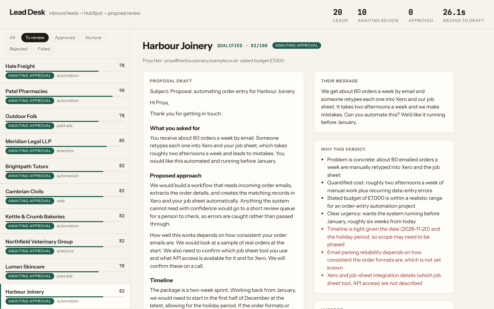
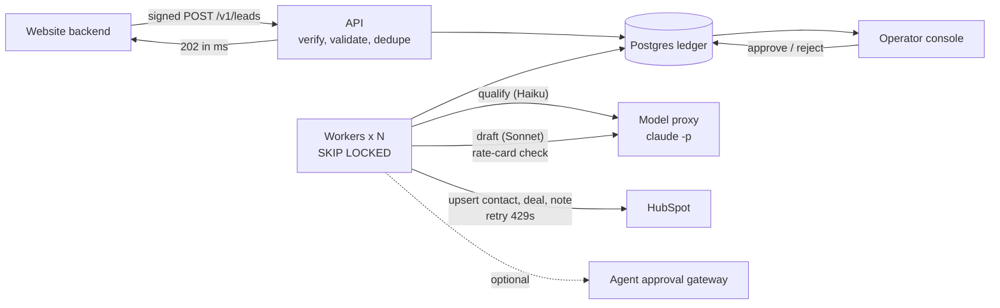

# lead-to-proposal

[](https://github.com/Idris-Michael/lead-to-proposal/actions/workflows/ci.yml)

Website enquiry → Claude qualifies it → HubSpot contact, deal and note → proposal draft → a person
approves it. Built twice, as a Python service and as an n8n workflow generated from the same
prompts, then benchmarked against each other on the same 20 leads, a duplicate drill and an
HTTP 429 drill.



> Framed as a pilot for a **fictional** 15-person UK digital agency ([brief](docs/engagement/brief.md)).
> The code, tests and measurements are real; the leads are synthetic.

## Results

Recorded runs, raw figures in [`bench/results.json`](bench/results.json). Both twins used the same
fake HubSpot server, the same models (Haiku 5.5 qualifies, Sonnet 5.5 drafts, through `claude -p`)
and four-way parallelism. Drills use an offline model so only the orchestration differs.

| | Python service | n8n twin | Evidence |
|---|---|---|---|
| Form submitter waits for a response (20 at once) | **0.21 s** median | 34.1 s median, 50.1 s max | Measured locally |
| Webhook → proposal draft, median / p90 | **26.0 s / 42.1 s** | 31.4 s / 49.2 s | Measured locally |
| Verdicts agreeing with hand labels | 19/20 | 19/20 | Measured locally |
| 20 leads re-sent + 5 double-clicks | 25/25 done, **0 duplicates** | 25/25 done, 0 duplicates | Fake HubSpot over HTTP |
| HubSpot calls for that drill | **97** | 175 | Fake HubSpot over HTTP |
| 30% of HubSpot calls answered 429 | **20/20** done | 19/20 done | Fake HubSpot over HTTP |
| 60% of HubSpot calls answered 429 | **20/20** done | 8/20 done | Fake HubSpot over HTTP |
| Live HubSpot portal | not yet run | not yet run | Client targets CRM v3; [runbook](docs/engagement/runbook.md) |
| Azure / AWS deployment | Terraform validated, tflint and checkov clean | | Validated offline, not deployed |

Both versions put one lead (a printing enquiry) in *nurture* instead of *reject*, and neither wrote
anything to HubSpot for the prompt-injection lead. Why the twins differ, and what would close the
gap on the n8n side, is in [ADR 1](docs/adr/0001-low-code-vs-code.md).

## How it works



- **The webhook only stores and acknowledges.** HMAC signature with a replay window, strict
  schema, dedupe by `Idempotency-Key` or by person + message, then `202` ([ADR 4](docs/adr/0004-webhook-acknowledges-then-queues.md)).
- **Each step writes to the ledger before the next starts,** so a killed worker resumes without a
  second model call or a second deal ([ADR 2](docs/adr/0002-ledger-first-steps.md)).
- **Every HubSpot write is safe to repeat.** Contacts upsert by email; deals carry a unique lead-key
  property; one retry loop honours `Retry-After` and backs off with jitter ([ADR 3](docs/adr/0003-hubspot-writes-and-429s.md)).
- **Guardrails are code, after the model.** Lead text is fenced as data, output is schema-validated,
  policy can only downgrade a verdict, and drafts may only quote rate-card prices or the client's
  own figures ([ADR 6](docs/adr/0006-guardrails-in-code.md)).
- **A person approves every draft,** in the console or through
  [agent-approval-gateway](https://github.com/Idris-Michael/agent-approval-gateway).

## What broke while building it

- **The first benchmark flagged good drafts as invented prices.** Drafts repeated the client's own
  figures ("you mentioned £40k a month") and the check allowed only the card price; it also read
  "£40k" as £40. Half the qualified leads paid for a second Sonnet call. The client's figures are now
  allowed and there is a regression test. With the fix, the next run regenerated no drafts.
- **The webhook serialised a burst.** Synchronous SQLAlchemy inside an `async` handler blocked the
  event loop. The insert now runs in a threadpool.
- **The benchmark measured itself.** A new HTTP client per request added about 1.5 s to every
  response under a 20-thread burst, which looked like the service being slow. One pooled client
  took Python's measured response from 1.6 s to 0.2 s.
- **n8n's retry made the expected 404 cost two extra calls.** "Retry On Fail" cannot tell a
  missing contact from a failure, so every new contact costs two wasted calls and two seconds.

## Run it

```bash
cp .env.example .env              # set WEBHOOK_SECRET and OPERATOR_TOKEN
docker compose up -d --build      # Postgres, migrations, API, worker, Jaeger (offline model, mock HubSpot)
export $(grep -v '^#' .env | xargs)
uv run python scripts/send_lead.py bench/leads.json --index 0
open http://localhost:8080        # console; traces at http://localhost:16686
```

Nothing leaves the machine with the defaults. To use Claude, run `uv run ltp-llm-proxy` on the host
and set `LLM_MODE=proxy`. For a HubSpot developer test account, set `HUBSPOT_MODE=live` and
`HUBSPOT_TOKEN`. Everything else is in the [runbook](docs/engagement/runbook.md).

```bash
uv sync && uv run pytest          # 72 tests, 80% coverage gate; Postgres tests need Docker
```

## Repository map

```
src/lead_to_proposal/   api, worker, pipeline (LangGraph), agent (prompts + guardrails),
                        hubspot (+ in-process fake), db (ledger), approvals, llm, llm_proxy
n8n/                    build_workflow.py → lead-to-proposal.json (the twin)
bench/                  leads.json (20 labelled), run.py, results.json
migrations/             Alembic
infra/                  Terraform: Azure Container Apps, AWS ECS Fargate
docs/                   engagement brief, security questionnaire, runbook, handover, ADRs
```

## Evidence labels
**Measured locally**: run on a Windows laptop with Docker Desktop; the model calls went to Anthropic
through `claude -p`. **Fake HubSpot over HTTP**: the CRM v3 endpoints this service uses, served by
`ltp-fake-hubspot` with fault injection. **Validated offline**: Terraform checked, never applied.

## Licence
MIT
